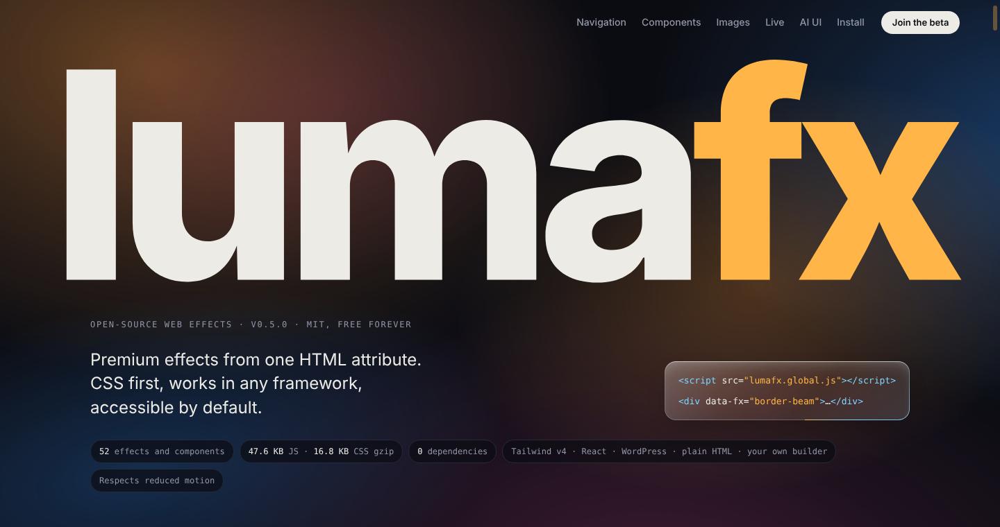
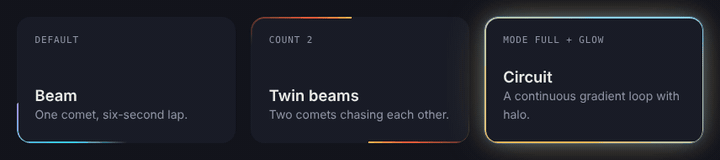
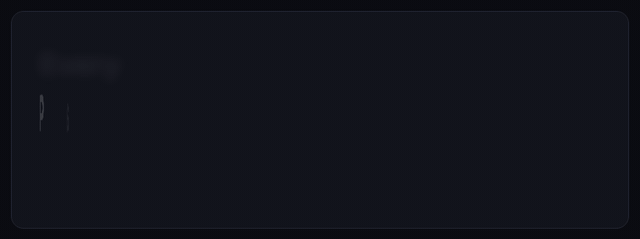
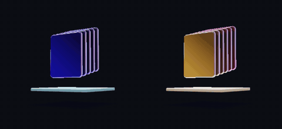
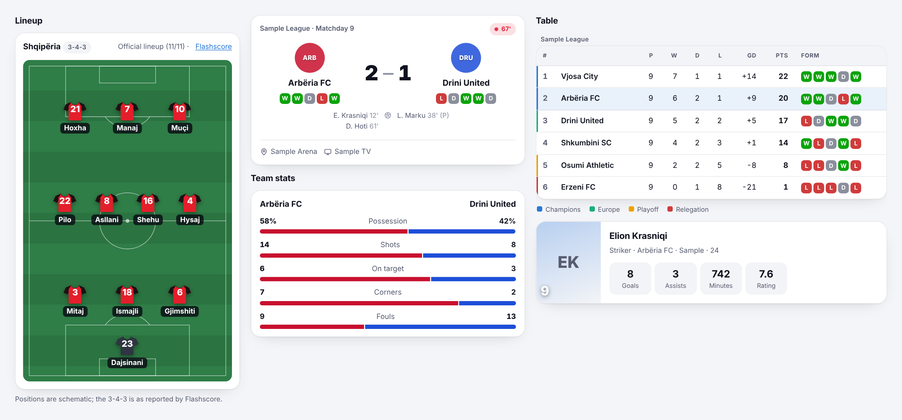
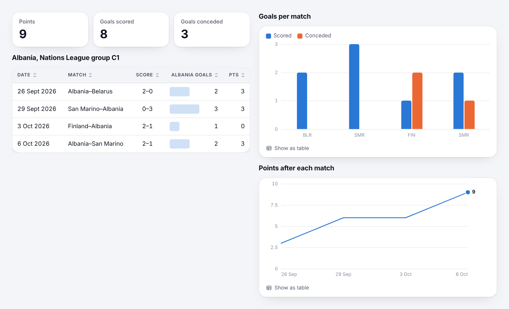
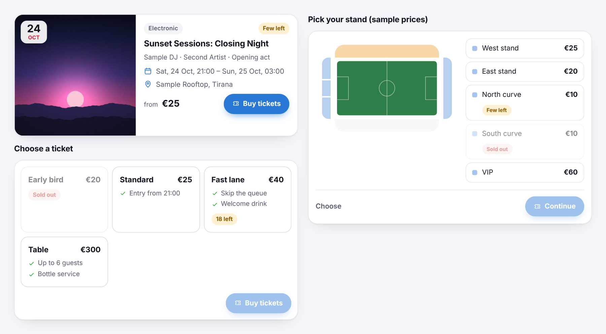
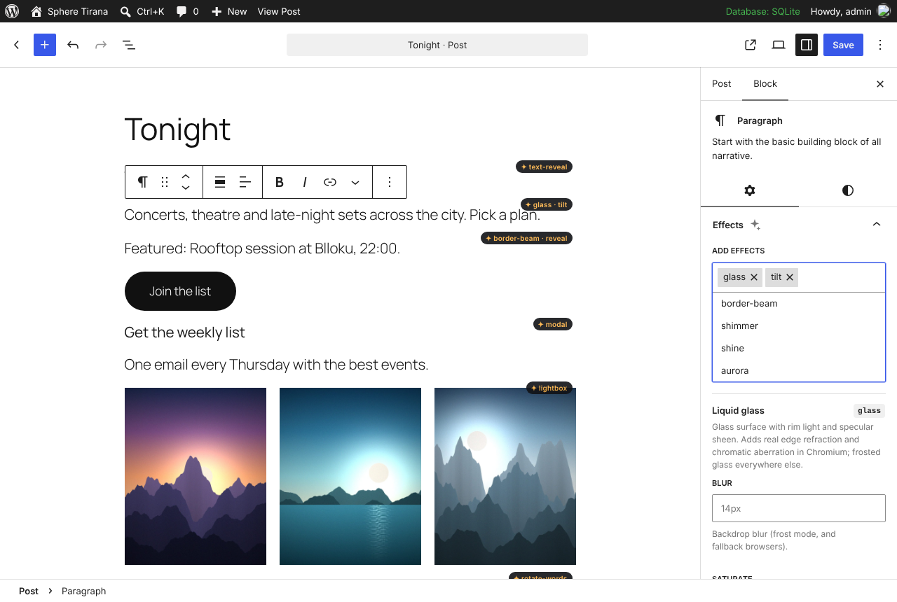
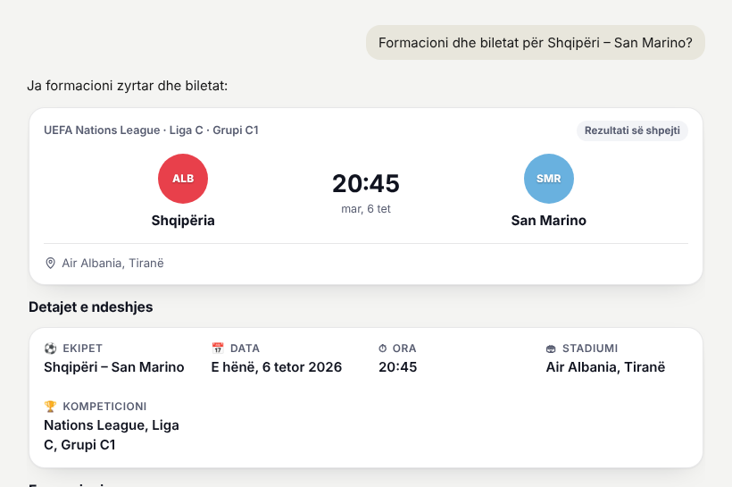

<h1 align="center">lumafx</h1>

<p align="center">
  <strong>Premium web effects, animated components and intelligent UI.<br>One HTML attribute. Any stack. Free forever.</strong>
</p>

<p align="center">
  <a href="LICENSE"></a>
  <a href="https://github.com/arrrrniii/lumafx/releases/latest"></a>
  <a href="https://github.com/arrrrniii/lumafx/actions/workflows/ci.yml"></a>
  
</p>

<p align="center">
  <a href="https://arrrrniii.github.io/lumafx/"></a>
  <br>
  <a href="https://arrrrniii.github.io/lumafx/"><strong>Open the live demo →</strong></a>
</p>

Border beams, liquid glass, page transitions, a liquid modal and drawers, scroll-scrubbed video, a chat widget, cards, smart forms, a WebGL 3D loader, text reveals and more: **52 effects and components**. A kit for putting them inside your own page builder. And **[intelligent UI](#intelligent-ui-lumafxui)**: blocks an AI writes as JSON (match cards, lineups, standings, tables, charts, tickets…) that render while they stream, on your site or inside Claude and ChatGPT.

- **Any stack.** Plain HTML, Webflow, Tailwind v4, React and Next.js (Server Components included), a [WordPress plugin](#wordpress) and an [MCP server](#in-claude-and-chatgpt-mcp).
- **CSS first.** Six effects are pure CSS and twelve more run in CSS with a JavaScript upgrade; the rest use a ~46 KB gzip runtime with no dependencies (or register only the ones you use).
- **Accessible by default.** `prefers-reduced-motion` everywhere, text effects stay readable for screen readers, everything works from the keyboard.
- **Never hides content.** Hidden "before" states only apply once the runtime runs, with a CSS failsafe if it never boots.
- **Cheap when idle.** Loops pause off-screen, pointer effects sleep until the mouse moves, Save-Data devices get a lighter version.
- **AI-ready.** Ships `llms.txt` and `effects.json` so coding agents apply effects correctly, and `lumafx/ui` so your own AI answers with real interface.

## Preview

| Border beam | Text reveal | 3D loader (WebGL) |
| :---: | :---: | :---: |
|  |  |  |

**Intelligent UI.** The model writes JSON; lumafx draws it while it is still writing, in your app, your blog or inside Claude and ChatGPT. Every block follows the light or dark theme (these previews switch with your GitHub theme).

<p align="center"></p>

<picture><source media="(prefers-color-scheme: dark)" srcset="docs/preview/ui-football-dark.png"></picture>

<picture><source media="(prefers-color-scheme: dark)" srcset="docs/preview/ui-data-dark.png"></picture>

<picture><source media="(prefers-color-scheme: dark)" srcset="docs/preview/ui-events-dark.png"></picture>

## What's in this repository

| Package | What it is | Get it |
| --- | --- | --- |
| **`lumafx`** | The effects, components, Tailwind plugin, React bindings, form rules, builder kit and `lumafx/ui` | [Script tag](#script-tag-any-website) · [npm from GitHub](#npm-from-github) |
| **`lumafx-mcp`** ([`mcp/`](mcp)) | MCP server and MCP Apps view: lumafx/ui inside Claude, ChatGPT and other MCP hosts | [Release tarball](#in-claude-and-chatgpt-mcp) |
| **WordPress plugin** ([`wordpress/`](wordpress)) | An Effects panel on every block, site-wide components, the `[lumafx_ui]` shortcode | [`lumafx-wordpress.zip`](https://github.com/arrrrniii/lumafx/releases/latest/download/lumafx-wordpress.zip) |

Every release on the [Releases page](https://github.com/arrrrniii/lumafx/releases) carries the three as files: `lumafx-<version>.tgz`, `lumafx-mcp-<version>.tgz` and `lumafx-wordpress.zip`. The built `dist/` folder is committed, so installs straight from GitHub need no build step.

## Install

### Script tag (any website)

Plain HTML, Webflow, Framer embeds, any CMS. The files come from this repository through the jsDelivr CDN; pin the version you tested with.

```html
<link rel="stylesheet" href="https://cdn.jsdelivr.net/gh/arrrrniii/lumafx@v0.5.0/dist/lumafx.css">
<script src="https://cdn.jsdelivr.net/gh/arrrrniii/lumafx@v0.5.0/dist/lumafx.global.js"></script>

<div data-fx="border-beam">…</div>
<h1 data-fx="text-reveal" data-fx-split="chars" data-fx-style="flip">Hello</h1>
<nav data-fx="glass">…</nav>
```

Put the script in `<head>` (no `defer`) so reveal effects never flash. Several effects on one element: `data-fx="tilt spotlight"`. Prefer to host the files yourself? Download `dist/` from a release and serve it from your own domain. To see these exact links working, open the [CDN test page](https://arrrrniii.github.io/lumafx/cdn-test.html).

| File | For |
| --- | --- |
| `dist/lumafx.css` + `dist/lumafx.global.js` | Effects and components |
| `dist/lumafx-ui.css` + `dist/lumafx-ui.global.js` | Intelligent UI (`<fx-ui>`, `lumafx.ui`) |
| `dist/lumafx-editor.global.js` | Builder kit (effects panel for your own editor) |
| `dist/transitions.css` | Native cross-document View Transitions only |

### npm (from GitHub)

```bash
npm install github:arrrrniii/lumafx#v0.5.0
# or: pnpm add github:arrrrniii/lumafx#v0.5.0 · yarn add lumafx@github:arrrrniii/lumafx#v0.5.0
```

It installs as `lumafx`, so every import below works as written. In `package.json` it reads `"lumafx": "github:arrrrniii/lumafx#v0.5.0"`; change the tag to upgrade.

```js
import 'lumafx/css';
import 'lumafx/auto'; // registers every effect and starts the runtime
```

Smallest bundle: register only what you use.

```js
import 'lumafx/css';
import { start, register } from 'lumafx/core';
import { tilt, magnetic, textReveal } from 'lumafx';
register(tilt, magnetic, textReveal);
start();
```

| Import | What |
| --- | --- |
| `lumafx/css`, `lumafx/auto`, `lumafx/core`, `lumafx` | Effects: styles, everything at once, the runtime, single effects |
| `lumafx/tailwind.css` | Tailwind v4 utilities |
| `lumafx/react`, `lumafx/react/runtime` | React components (Server Components) and the client runtime |
| `lumafx/forms` | Form rules shared by browser and server |
| `lumafx/editor` | Builder kit |
| `lumafx/ui`, `lumafx/ui/server`, `lumafx/ui.css` | Intelligent UI: browser renderer, server renderer and schemas, styles |
| `lumafx/react/ui` | `<FxUI>` server component and `<FxUIStream>` |

### Tailwind CSS v4

```css
@import "tailwindcss";
@import "lumafx/tailwind.css";
```

```html
<div class="fx-border-beam fx-duration-4000 fx-color-amber-400 fx-color2-sky-400 rounded-2xl">…</div>
<h1 class="fx-text-reveal fx-split-chars fx-style-flip">Hello</h1>
```

Effects are real Tailwind utilities, so only the ones you use end up in your CSS. Option utilities: `fx-duration-*`, `fx-delay-*`, `fx-stagger-*`, `fx-color-*`, `fx-color2-*`, `fx-color3-*`, `fx-length-*`, `fx-width-*`, `fx-radius-*`, `fx-blur-*`, `fx-gap-*`, `fx-from-*`, `fx-split-*`, `fx-style-*` and more (see `dist/tailwind.css`). Interactive effects (`fx-magnetic`, `fx-tilt`…) also need the runtime script or `import 'lumafx/auto'`.

### React and Next.js

```tsx
// app/layout.tsx
import 'lumafx/css';
import { FxRuntime } from 'lumafx/react/runtime';

export default function RootLayout({ children }) {
  return <html><body>{children}<FxRuntime /></body></html>;
}
```

```tsx
// any Server Component
import { BorderBeam, TextReveal, Tilt, Marquee } from 'lumafx/react';

<TextReveal as="h1" split="chars" style="flip">Hello</TextReveal>
<BorderBeam className="card" duration="5s" glow>…</BorderBeam>
```

The components render plain elements with `data-fx` attributes: no hooks, no `"use client"`. Only `<FxRuntime />` is a client component.

### WordPress

1. Download [`lumafx-wordpress.zip`](https://github.com/arrrrniii/lumafx/releases/latest/download/lumafx-wordpress.zip) from the latest release.
2. In WordPress: **Plugins → Add New → Upload Plugin**, choose the zip, **Install Now**, **Activate**.
3. Open any page in the block editor: every block now has an **Effects** panel in the sidebar.

- **Every block gets an Effects panel.** Pick effects, set options, publish. Nothing is written into your post markup: the attributes are added while the page renders, so deactivating the plugin leaves every post valid.
- **Settings → lumafx** turns on site-wide pieces: page transitions, the preloader, the animated scrollbar, reading progress, the chat widget (it can hand conversations to WhatsApp), a smart header and menu hover icons for any theme, by CSS selector.
- **Liquid modal without code:** give a Group block an HTML anchor such as `join`, add the `modal` effect, link any button to `#join`.
- **Intelligent UI:** `[lumafx_ui lang="sq"]{"blocks":[…]}[/lumafx_ui]`, `[lumafx_ui src="https://…/ui.json"]`, or `<fx-ui>` in a Custom HTML block.
- **Elementor, Bricks, Divi:** add effects as CSS classes (`fx-reveal`, `fx-glass`…) and options as attributes (`data-fx-duration="4s"`).



To update, upload the newer zip; WordPress offers to replace the installed version. Tested on WordPress 7.1 with a block theme (`npm run test:wordpress`).

### Claude, ChatGPT and other MCP hosts

See [In Claude and ChatGPT (MCP)](#in-claude-and-chatgpt-mcp) below: one line in your MCP config.

## Page transitions

Between pages of any multi-page site, place one element anywhere in `<body>`:

```html
<div data-fx="page-transition" data-fx-style="wave" data-fx-label="Sphere"></div>
```

Styles: `wave` (SVG curves), `curtain`, `circle` (grows from the click), `slide`. Same-origin links cover the page, the next page arrives already covered and reveals itself, so nothing flashes in between. Opt a link out with `data-fx-no-transition`, or choose which links count with `data-fx-links="nav a"`. In a single-page app, call `lumafx.page.cover()` before your route change and `lumafx.page.reveal()` after it.

For browser-native cross-document View Transitions instead:

```html
<link rel="stylesheet" href="https://cdn.jsdelivr.net/gh/arrrrniii/lumafx@v0.5.0/dist/transitions.css">
<html data-fx-transition="slide">
```

Presets: `fade`, `slide`, `slide-back`, `zoom`, `wipe`. Within a page, `lumafx.transition(() => render(), { preset: 'zoom' })`, and `data-fx="morph" data-fx-name="hero"` for shared elements.

## Components

```html
<!-- Liquid modal: rises out of the bottom edge like a drop and detaches -->
<button data-fx-open="#join">Join</button>
<dialog id="join" data-fx="modal">… <button data-fx-close>Close</button></dialog>

<!-- Chat widget: connect any backend through the fx:chat-send event -->
<div id="chat" data-fx="chat" data-fx-title="Support" data-fx-greeting="Hi! How can we help?" data-fx-quick="Prices, Opening hours"></div>
<script>
  chat.addEventListener('fx:chat-send', async (e) => chat.fxChat.reply(await answer(e.detail.text)));
</script>

<!-- Smart header with a hero logo that docks into the bar as you scroll -->
<header data-fx="smart-header"><a data-fx-logo="0.9">mejuma</a><nav data-fx="hover-icon">…</nav></header>

<!-- Animated scrollbar with section marks and a label next to the cursor -->
<div data-fx="scrollbar" data-fx-sections="h2"></div>

<!-- Drawer: a side panel or bottom sheet. Styles: slide, glass, scale, push, dock, liquid -->
<button data-fx-open="#edit">Edit</button>
<dialog id="edit" data-fx="drawer" data-fx-side="right" data-fx-style="push">…</dialog>
```

Also: `hovercard`, `dock`, `lightbox`, `preloader`, `scroll-progress`. Modals and drawers open from `data-fx-open="#id"`, any link to `#id`, or `lumafx.modals.open('#id')`; the liquid style flows out of whatever opened them. Drawers close on a click outside, Esc or `data-fx-close`, leaving the way they came. `push` slides the whole page over to make room and `dock` reflows the page beside the panel so it stays usable. Both move the element marked `data-fx-sheet-root` (or `#__next`, `#root`, `#app`, `.wp-site-blocks`), so wrap your page in one for the best result.

## Cards and buttons

```html
<article data-fx="card" data-fx-style="product">
  <figure></figure>
  <div>
    <h3>Ksamil by boat</h3><p>Four islands, one lunch.</p>
    <footer><strong>€45</strong><button data-fx="press" data-fx-style="burst" data-fx-done="Added ✓">Add to cart</button></footer>
  </div>
</article>
```

Card styles: `glow` (the border lights up around the cursor), `product`, `flip` (the last child is the back side), `cover`, `ticket`. `press` works on any button or link: `ripple`, `burst`, `fill`, `squish`, plus an optional done label.

## Forms: one set of rules for the browser and the server

```html
<form data-fx="form" data-fx-ajax action="/api/join" method="post">
  <input name="email" type="email" required>
  <input name="phone" type="tel" data-rules="phone:AL">
  <input name="password" type="password" required data-rules="password">
  <input name="confirm" type="password" data-rules="match:password">
  <button data-fx-sent="You're in ✓">Join</button>
</form>
```

```ts
// app/api/join/route.ts (Next.js); works the same in Express, Hono or a server action
import { schema } from 'lumafx/forms';

const join = schema({ email: 'required email', phone: 'phone:AL', password: 'required password', confirm: 'match:password' });

export async function POST(req: Request) {
  const r = join.validate(await req.formData(), { spam: true, locale: 'sq' });
  if (!r.ok) return Response.json(r, { status: 422 }); // errors land on their fields
  // r.data is cleaned: trimmed, lower-cased email, phone as +355691234567
  return Response.json({ ok: true });
}
```

Rules: `required email phone[:CC] url number integer min:n max:n minlength:n maxlength:n match:field password name pattern:"re" oneof:a|b accepted date`, plus your own with `addRule(name, fn, messages)`. Email typos get a "Did you mean…?" fix, phone numbers are parsed for 40+ countries and formatted internationally, passwords get a strength meter, and a honeypot plus a time trap stop most bots (`spam: true` checks them on the server). Messages in English and Albanian (`locale: 'sq'`). Events: `fx:invalid`, `fx:submit` (cancelable, for your own fetch), `fx:success`.

## Loading

```html
<div data-fx="loader-3d"></div>                         <!-- pages: open like a book, spread into a ring -->
<div data-fx="loader-3d" data-fx-style="stack"></div>    <!-- flat tiles fanning apart -->
<div data-fx="loader-3d" data-fx-colors="#ffc15e,#ff8a4c,#ff4f7b" data-fx-base="#ffe6cc"></div>

<!-- As the page preloader -->
<div data-fx="preloader" data-fx-style="fade"><div data-fx="loader-3d"></div><span data-fx-count></span></div>
```

```js
// Blog pagination: the loader appears in the grid while the request runs.
const posts = await lumafx.loading('#posts', fetch('/api/posts?page=2').then((r) => r.json()));
```

## Builder kit

`lumafx/editor` is for people building a page builder, CMS or design tool (or a dashboard with drag-and-drop sections). Every piece is a plain function, so it fits React, Vue, Svelte or vanilla code.

```js
import { toAttributes, apply, preview, replay, catalog, PRESETS, sortable, place, discard } from 'lumafx/editor';

// Store effects as data in your block JSON…
block.fx = [{ effect: 'reveal', options: { from: 'zoom' } }, { effect: 'tilt' }];
// …and render them as attributes, on the server or in the browser.
toAttributes(block.fx);   // { 'data-fx': 'reveal tilt', 'data-fx-from': 'zoom' }
apply(el, 'chars-flip');  // a preset id, an effect name or specs
const undo = preview(el, 'blur-in'); // try it on hover, undo() on leave
replay(el);               // play entrance effects again after an edit

// Build your own panel from the metadata: groups, presets and form fields per option.
catalog(); // [{ name, title, desc, group, fit, fields: [{ key, type: 'select' | 'range' | 'time' …, default }] }]

// Canvas motion: springy drag-to-reorder, a palette that creates blocks, smooth insert and delete.
sortable(canvas, { group: 'page', onEnd: (e) => save(e) });
sortable(palette, { group: 'page', clone: (tile) => makeBlock(tile.dataset.block) });
place(newBlock, canvas, refBlock); // neighbours glide out of the way
discard(block);                    // it shrinks away and the gap closes
```

Or drop in the ready panel: presets with live previews on the block, options generated from the metadata, replay, and a copyable attribute string.

```html
<script src="https://cdn.jsdelivr.net/gh/arrrrniii/lumafx@v0.5.0/dist/lumafx-editor.global.js"></script>
<fx-panel></fx-panel>
<script>
  const panel = document.querySelector('fx-panel');
  panel.target = selectedBlock;
  panel.addEventListener('fx-change', (e) => save(selectedBlock.id, e.detail.fx));
</script>
```

Theme it with CSS variables (`--fxp-bg`, `--fxp-fg`, `--fxp-accent`…) or `theme="light"`. Email builders: inboxes don't run JavaScript and most strip CSS animation, so use the kit for web pages.

## Intelligent UI (lumafx/ui)

Let your AI answer with interface instead of walls of text. The model writes JSON blocks; lumafx renders them while it is still writing, in your chat, in a blog post, or inside Claude and ChatGPT through [MCP](#in-claude-and-chatgpt-mcp).

**47 blocks.** Sport: `match` (any sport, live minute, scorers), `lineup` (formation on a pitch, kits, captain, bench), `fixtures` (results and kickoffs by day), `events` (timeline of goals and cards), `match-stats`, `standings` (zones, form), `h2h`, `player`, `scoreboard` (periods), `tennis`, `race` (F1, athletics), `fight` (MMA, boxing), `bracket`. Events and tickets: `event`, `tickets`, `listing` (what's on, grouped by day, with category filters), `zones` (stadium, arena, theatre or club seat map), `venue`, `schedule`, `artists`. Data: `table`, `stats`, `chart` (line, area, column, stacked, bar, donut, with a table view), `compare`, `progress`, `weather`. Answers: `text`, `callout`, `tabs`, `group`, `faq`, `details`, `steps`, `timeline`, `product`, `gallery`, `image`, `video` (YouTube and Vimeo, one or a playlist; nothing loads before a click), `quote`, `places`, `itinerary`, `quiz`, `poll`, `actions`, `suggestions` (follow-up questions), `sources`, `countdown`.

**Aware of time.** An `event` sells tickets before it starts, shows "Happening now" while it runs and "Ended" (with an optional `recap` link) afterwards; `tickets` close at `closes`; a `match` past kickoff stops selling and waits for the result; listings dim what is over. Server-rendered HTML catches up when it hydrates, and open pages update on their own at the right moment.

**Evidence on any block.** Add `evidence: { status: 'verified' | 'reported' | 'unconfirmed' | 'analysis', source, asOf, url }` and the block gets a small "Verified · 7 Oct, 12:06 · FSHF" line.

**Structured data from the same blocks.** `jsonLd(doc, { url, headline, datePublished, author })` (or `jsonLdScript`) returns schema.org Article, Event and MusicEvent with offers and performers, SportsEvent, FAQPage, ItemList, VideoObject and BreadcrumbList, so search engines and AI assistants read what your readers see.

```js
// 1. Tell the model about the blocks: a tool, or a compact reference for the system prompt.
import { anthropicTool, openaiTool, prompt, jsonSchema, validate } from 'lumafx/ui/server';
const tools = [anthropicTool({ types: ['match', 'lineup', 'standings', 'tickets', 'text', 'suggestions'] })];

// 2. Render while it streams.
import { stream } from 'lumafx/ui';
const s = stream(el, { lang: 'sq', timeZone: 'Europe/Tirane' });
onDelta((json) => s.write(json));       // partial JSON is fine
onDone(() => s.end());                   // strict validation; returns { doc, errors }
el.addEventListener('fxui:ask', (e) => sendMessage(e.detail.text));   // follow-up chips
el.addEventListener('fxui:select', (e) => holdSeats(e.detail));        // ticket tier or stand

// 3. Keep blocks live: any block with { live: { adapter, id } } updates itself.
import { adapter, update } from 'lumafx/ui';
adapter.set('scores', { subscribe: (id, block, push) => feed.watch(`match:${id}`, push) }); // return an unsubscribe function
update(el, 'alb-smr', { status: 'live', score: [2, 0], minute: "67'" }); // or by hand
```

On a page, server-render for SEO and let the browser wake it up:

```js
import { renderToString } from 'lumafx/ui/server';           // Node, Deno, Bun, workers
const html = renderToString(doc, { timeZone: 'Europe/Tirane' });  // embeds the JSON for hydration
// in the browser: <script src=".../lumafx-ui.global.js"> or import 'lumafx/ui'; then lumafx.ui.hydrate(el)
```

```html
<link rel="stylesheet" href="https://cdn.jsdelivr.net/gh/arrrrniii/lumafx@v0.5.0/dist/lumafx-ui.css">
<script src="https://cdn.jsdelivr.net/gh/arrrrniii/lumafx@v0.5.0/dist/lumafx-ui.global.js" defer></script>

<fx-ui lang="sq" time-zone="Europe/Tirane" ask-url="/kerko?q=">
  <script type="application/json">{"blocks":[{"type":"match", "home":{"name":"Shqipëria"}, "away":{"name":"San Marino"}, "kickoff":"2026-10-06T20:45:00+02:00"}]}</script>
</fx-ui>
<fx-ui src="/api/match/123/ui.json"></fx-ui>
```

React and Next.js: `<FxUI doc={post.ui} timeZone="Europe/Tirane" />` from `lumafx/react/ui` renders on the server (no client JS of its own); add `<FxUIRuntime />` from `lumafx/react/runtime` once for interactivity. In a chat, `<FxUIStream value={argsSoFar} done={finished} onAsk={send} />` streams. WordPress: `[lumafx_ui lang="sq"]{"blocks":[…]}[/lumafx_ui]`, `[lumafx_ui src="https://…/ui.json"]`, or `<fx-ui>` in a Custom HTML block.

Safe by design: everything a model writes is escaped, links are limited to http(s), mailto and tel, colors and dates are checked, unknown blocks and fields are dropped, and `validate()` returns the fixes so you can send them back to the model. Labels in English and Albanian (`addLabels('it', {...})` for more), light and dark themes (`theme="dark"` or `--fxui-*` variables), keyboard and screen-reader friendly, reduced motion respected. Charts follow a colorblind-checked palette and every chart has a table view.

### In Claude and ChatGPT (MCP)



[`lumafx-mcp`](mcp/README.md) is an MCP server with one tool, `render_ui`, and an MCP Apps view. Hosts that support MCP Apps show the blocks inline and stream them while the model writes; follow-up chips become the next message, links open through the host, ticket picks reach the model's context. Hosts without UI get a plain-text version. It needs Node 20 or newer.

**Claude Desktop, Cursor, VS Code and other local hosts** (stdio). Add to the host's MCP config, e.g. `claude_desktop_config.json`:

```json
{
  "mcpServers": {
    "lumafx": {
      "command": "npx",
      "args": ["-y", "https://github.com/arrrrniii/lumafx/releases/download/v0.5.0/lumafx-mcp-0.5.0.tgz", "--stdio"]
    }
  }
}
```

**Claude.ai, ChatGPT and other remote hosts** (Streamable HTTP). Run it on a server and add `https://your-host/mcp` as a custom connector:

```bash
npx -y https://github.com/arrrrniii/lumafx/releases/download/v0.5.0/lumafx-mcp-0.5.0.tgz --host 0.0.0.0 --port 3001
# serves http://<server>:3001/mcp; put it behind HTTPS (Caddy, nginx, Cloudflare Tunnel)
```

**Inside your own MCP server**, so your own tools answer with the same view:

```bash
npm install https://github.com/arrrrniii/lumafx/releases/download/v0.5.0/lumafx-mcp-0.5.0.tgz
```

```js
import { registerUI, uiToolMeta, uiResult } from 'lumafx-mcp';
registerUI(server, { imageDomains: ['https://sphere.al'] });
server.registerTool('get_event', { inputSchema, _meta: uiToolMeta }, async ({ slug }) => uiResult(toBlocks(await getEvent(slug))));
```

Options, the view's events and the protocol details are in [`mcp/README.md`](mcp/README.md).

## Scroll-scrubbed video and image sequences

```html
<section data-fx="video-scrub" data-fx-length="300vh">
  <video src="flight.mp4" muted playsinline preload="auto"></video>
  <h2>Titles float over the video</h2>
</section>
```

The video plays as you scroll down and rewinds as you scroll up. Encode with short keyframe intervals for smooth seeking (`ffmpeg -i in.mp4 -g 6 -crf 23 -an out.mp4`). If the server doesn't support range requests, the runtime loads the file into memory once so seeking still works. For the sharpest result use `frames` with numbered images: `data-fx-src="/seq/frame-###.jpg" data-fx-count="90"`. Both expose `--fx-p` (0–1) to their children for scroll-linked titles.

## Effects

<!-- effects:start -->
| Effect | Runs on | What it does | Options |
|---|---|---|---|
| `border-beam` | CSS | A comet of light that travels around the element border. Set mode="full" for a continuous gradient circuit. | `duration`, `delay`, `color`, `color-2`, `length`, `width`, `count`, `mode`, `glow` |
| `shimmer` | CSS | A band of light sweeps across text. Keeps the real text selectable and accessible. | `duration`, `color`, `color-2` |
| `shine` | CSS | A glossy highlight sweeps across a surface such as a button or card. | `duration`, `intensity`, `trigger` |
| `aurora` | CSS | Slow, drifting aurora light behind the content of a section. | `duration`, `color`, `color-2`, `color-3`, `opacity` |
| `squircle` | CSS + JS | Smooth, continuous iOS-style corners. Native corner-shape where supported, an SVG clip-path fallback elsewhere. | `radius`, `smoothing`, `fallback` |
| `glass` | CSS + JS | Glass surface with rim light and specular sheen. Adds real edge refraction and chromatic aberration in Chromium; frosted glass everywhere else. | `blur`, `saturate`, `tint`, `refraction`, `aberration`, `mode` |
| `shadow` | CSS + JS | Five-layer soft shadow that looks physical. Optional hover lift, or a light source that follows the cursor. | `elevation`, `color`, `lift`, `light` |
| `reveal` | JS | Animates the element in when it scrolls into view. Never leaves content hidden if JavaScript fails. | `from`, `duration`, `delay`, `distance`, `ease`, `once` |
| `stagger` | JS | Reveals each child one after another when the group scrolls into view. | `from`, `stagger`, `duration`, `delay`, `distance`, `ease`, `once` |
| `text-reveal` | JS | Splits text into words, letters or lines and animates them in. Keeps links and inline markup intact. | `split`, `style`, `stagger`, `duration`, `delay`, `trigger`, `once` |
| `scramble` | JS | Letters decode from random characters into the final text. | `trigger`, `speed`, `chars` |
| `counter` | JS | Counts up to the number in the text when it scrolls into view. Keeps prefixes, suffixes and the original number format. | `from`, `duration` |
| `marquee` | CSS + JS | Seamless infinite scroll of logos or cards with soft edges. Pauses on hover. | `speed`, `gap`, `fade`, `reverse`, `vertical`, `pause` |
| `spotlight` | JS | A soft light and a glowing border follow the cursor across the card. | `color`, `size`, `border` |
| `magnetic` | JS | The element is pulled toward the cursor when it gets close, then springs back. | `strength`, `area` |
| `tilt` | JS | Tilts toward the cursor in 3D with a moving light reflection. Children with data-fx-depth float above the surface. | `max`, `scale`, `perspective`, `glare` |
| `cursor-image` | JS | Hovering shows an image, icon or label that follows the cursor with a little momentum. | `src`, `label`, `size`, `cursor` |
| `parallax` | CSS + JS | Moves at a different speed than the page while scrolling. Runs on the compositor in modern browsers. | `speed` |
| `stack` | CSS + JS | Children stick and stack on top of each other while scrolling; covered cards shrink and dim. | `top`, `offset`, `shrink` |
| `hscroll` | CSS + JS | Vertical scrolling moves a row of panels sideways while the section is pinned. | `gap` |
| `carousel` | CSS + JS | Native scroll-snap carousel with mouse drag and momentum, keyboard support and optional controls. | `slide`, `gap`, `style`, `controls`, `autoplay` |
| `stories` | JS | Instagram-style stories: progress bars, tap left/right, hold to pause, swipe. | `duration`, `loop` |
| `ripple` | WebGL | Liquid ripples, lens magnification and RGB split follow the cursor over an image. | `strength`, `src` |
| `morph` | JS | Names an element for View Transitions so it morphs between states or pages. Pair with lumafx.transition() or transitions.css. | `name` |
| `page-transition` | JS | Animated SVG cover between pages of any site (WordPress and Webflow included). Covers on leave, reveals on arrival. Place one element anywhere in <body>. | `style`, `color`, `color-2`, `duration`, `label`, `links` |
| `preloader` | JS | Full-screen intro with a 000→100 counter that follows real page loading, then lifts away. Hides itself after a few seconds even if JavaScript fails. | `style`, `color`, `min` |
| `modal` | JS | Accessible <dialog> that pulls out of the button, dock icon or link that opened it like a drop of liquid, detaches, and blooms into the panel; closing flows back into the trigger. Without a trigger it rises from the bottom edge. Open it with data-fx-open="#id", any link to href="#id", or modals.open(). | `style`, `from`, `side`, `size`, `root`, `color` |
| `drawer` | JS | A side panel or bottom sheet on a <dialog>: slides in with a spring, as stretchy liquid glass, with the page shrinking back behind it, pushing the page aside to make room, docked next to a page that stays usable, or as liquid out of the button that opened it. Click outside, Esc or data-fx-close closes it with the reverse animation. | `side`, `style`, `size`, `color`, `from`, `root` |
| `hovercard` | JS | A small card that springs open right next to the hovered or focused element and stays inside the viewport. | `for`, `text`, `placement`, `delay` |
| `chat` | JS | Animated chat launcher and panel: the button morphs into the window, messages slide in, a typing indicator bounces. Emits fx:chat-send so you can connect any backend. | `title`, `subtitle`, `greeting`, `placeholder`, `quick`, `color`, `position` |
| `smart-header` | CSS + JS | Hides while you scroll down, slides back as glass when you scroll up, and can dock an oversized hero logo into the bar as you scroll. | `threshold`, `hide` |
| `scrollbar` | JS | Custom page scrollbar with a springy thumb, section marks, and a label that pops up next to the cursor showing which section is at that point. | `sections`, `color` |
| `scroll-progress` | CSS + JS | A reading-progress bar that fills as the page scrolls. Runs on the compositor in modern browsers. | `color`, `height` |
| `dock` | JS | Icons grow as the cursor passes over them, like the macOS dock. Labels appear above the hovered icon. | `magnify`, `range` |
| `hover-icon` | CSS | Menu links slide an icon in on hover while the text makes room. Uses the data-fx-icon text, or a child marked data-fx-icon-el. | `icon`, `side` |
| `lightbox` | JS | Click a thumbnail and it grows into a full-screen viewer (View Transitions), with keyboard, swipe, zoom and a counter. Put it on a link to a large image, or on a gallery to page through every linked image inside. | `group` |
| `image-reveal` | JS | The image is uncovered by a moving mask while it settles from a slight zoom. Seven mask shapes. | `from`, `duration`, `delay`, `scale` |
| `expand` | CSS + JS | An inset, rounded image or video grows to full width as it scrolls into the middle of the screen. | `inset`, `radius` |
| `image-trail` | JS | Moving the cursor leaves a trail of images that pop in and fade away. | `images`, `size`, `spacing` |
| `video-scrub` | JS | The video plays forward as you scroll down and backward as you scroll up, pinned while its section passes. | `length`, `smooth` |
| `frames` | JS | Apple-style scroll animation from numbered images drawn on a canvas. Sharper and smoother to scrub than video. | `src`, `count`, `start`, `length` |
| `svg-draw` | JS | Draws the strokes of an SVG when it scrolls into view (or with the scroll), and can send glowing pulses travelling along the paths. | `mode`, `duration`, `stagger`, `pulse`, `color` |
| `dot-field` | JS | A grid of dots that ripples away from the cursor and breathes when idle. | `color`, `gap`, `force` |
| `typewriter` | JS | Types the text letter by letter with a blinking caret. Child lines type one after another, like a terminal. | `speed`, `delay`, `loop` |
| `rotate-words` | JS | Cycles through a list of words in place, with the width easing between them. | `words`, `interval`, `style` |
| `clock` | JS | Shows the live time in any time zone, ticking every second. | `tz`, `seconds`, `hour12` |
| `dapple` | CSS | Soft, slowly swaying shadows of leaves over a section, like sunlight through a tree. | `opacity`, `duration` |
| `ring` | JS | Items stand on a 3D ring you can drag and fling; it turns slowly on its own when idle. | `speed`, `tilt` |
| `card` | CSS + JS | Five ready card designs for an image, a title, text and buttons: glow (border lights up around the cursor), product (lifts, image zooms), flip (3D flip to a back side), cover (full-bleed image, details slide up), ticket (event ticket with a perforated stub). | `style`, `color`, `radius` |
| `press` | JS | Click feedback for buttons and links: a ripple from the click point, a burst of sparks, a fill that follows the cursor in and out, or a squish. Can swap the label to a done state ("Added ✓"). | `style`, `color`, `done` |
| `form` | JS | Validation that feels alive, with the same rules on your server: messages slide in under the field, email typos get a "Did you mean…?" fix, phone numbers settle into international format, passwords get a strength meter, and AJAX submits show server errors on the right fields. Rules come from native attributes (required, type="email", minlength…) or data-rules="required email phone:AL". | `locale`, `country`, `ajax`, `spam`, `reset`, `success`, `color` |
| `loader-3d` | WebGL | Glossy 3D panels over a floating glass plate, rendered live on the GPU with soft shadows and studio reflections. pages: upright panels open like a book, spread into a ring and fold back. stack: flat tiles fan apart. For page preloaders, loading blog posts and any wait. Falls back to CSS 3D without WebGL; one shared GPU context serves every loader on the page. | `style`, `colors`, `count`, `base`, `duration`, `size` |
<!-- effects:end -->

Options are `data-fx-<option>` attributes. Bare numbers get a unit from the option type: time → ms, length → px, percent → %.

## JavaScript API

| Function | |
|---|---|
| `start(options?)` | Mounts every effect and watches the DOM. Options: `root`, `motion: 'reduce'`, `lite`, `features` (override detection, e.g. `{ sda: false }` to test fallbacks). |
| `stop()` / `refresh()` | Unmount everything / re-detect and remount. |
| `mount(root)` | Mount immediately after injecting HTML (otherwise it happens on the next microtask). |
| `register(effect)` | Add your own effect: `{ name, meta, mount(el, ctx) { …; return cleanup } }`. |
| `transition(update, { preset })` | Run a DOM update inside a View Transition. |
| `page.cover(x?, y?)` / `page.reveal()` | Play the page-transition cover and reveal yourself (single-page apps). |
| `modals.open(target, { from })` / `modals.close(target)` | Open or close a modal or drawer by selector or element. `from` is the element the liquid flows out of. |
| `loading(target, promise, options?)` | Shows a `loader-3d` in `target` while the promise runs, marks it `aria-busy`, resolves with the result. Options: `colors`, `size`, `min`, `overlay`. |
| `forms` | The isomorphic validation API (`schema`, `validate`, `parsePhone`, `suggestEmail`, `addRule`), also at `lumafx/forms`. |
| `form.fxForm` | On a smart form: `validate()`, `values()`, `showErrors(errors)`. |
| `el.fxChat` | On a chat widget: `open()`, `close()`, `reply(text, { typing })`, `typing(on)`, `send(text)`. |
| `stats()` | Which effects are running on how many elements. |

Opt an area out with `data-fx-off`. Events: `fx:loaded` (preloader finished), `fx:open` / `fx:close` (modal, drawer), `fx:chat-send` / `fx:chat-open` (chat), `fx:invalid` / `fx:submit` / `fx:success` (form), `fx:sort` (editor `sortable`).

When a `preloader` is on the page, entrance effects (reveal, text-reveal, counter, image-reveal, svg-draw, typewriter…) wait for it, so they play as the curtain lifts instead of behind it.

## Browser support

Everything works in current Chrome, Edge, Safari and Firefox. Some effects upgrade where the browser can do more:

| Feature | Chrome / Edge | Safari | Firefox | Fallback |
|---|---|---|---|---|
| Glass refraction | ✓ | frosted | frosted | Blur, rim light and sheen |
| Native squircle (`corner-shape`) | 139+ | clip-path | clip-path | Exact SVG clip-path (or plain radius if the element has a border or shadow) |
| Scroll-driven parallax / hscroll | ✓ | 26+ | JS | Same motion driven from JavaScript |
| Native View Transitions | ✓ | 18+ | same-document only | Instant navigation |
| Lightbox morph (View Transitions) | ✓ | 18+ | ✓ | Opens without the morph |
| `expand`, `scroll-progress` on the compositor | ✓ | 26+ | JS | Same motion driven from JavaScript |
| Liquid modal (SVG goo filter) | ✓ | ✓ | ✓ | Fade when reduced motion is on |
| `loader-3d` (WebGL) | ✓ | ✓ | ✓ | CSS 3D version without WebGL; a still frame with reduced motion |

## Performance notes

- Liquid glass re-renders its filter whenever something moves underneath it. Use it on a handful of elements, not on dozens.
- The WebGL ripple creates one WebGL context per image, lazily on first hover. Browsers cap contexts at around 16 per page.
- `tilt` writes `transform` and `magnetic` writes `translate` inline; don't animate those properties yourself on the same element.
- Avoid `overflow: hidden` on a `tilt` element if you use `data-fx-depth` children (it flattens 3D).
- `video-scrub` seeks a video on every frame. Keep the file short (a few seconds) and encode it with frequent keyframes; for long or heavy scenes prefer `frames`.
- The full runtime is about 46 KB gzip. With a bundler, `lumafx/core` plus `register()` only ships the effects you import.
- `loader-3d` ray-marches its scene in a fragment shader. Every loader on the page shares one WebGL context, renders only while on screen, and lowers its resolution by itself on slow devices.

## Development

```bash
git clone https://github.com/arrrrniii/lumafx.git && cd lumafx
npm install
npm run build          # dist/, llms.txt, demo/ and the WordPress zip
npm test               # unit tests (Vitest + jsdom)
npm run test:tailwind  # compiles a sample project with the Tailwind v4 CLI
npm run test:browser   # headless Chromium: every effect, fallbacks, reduced motion, phone (Python + Playwright)
npm run test:wordpress # real WordPress (SQLite, block theme): plugin internals, front end, block editor
cd mcp && npm install && npm run build && npm test && npm run test:view   # MCP server and its view
```

`node scripts/build.mjs` also regenerates the demo (`demo/index.html`), `llms.txt`, the README effects table and the WordPress plugin zip. `python3 scripts/make_media.py` regenerates the demo video and image sequence, and `python3 scripts/previews.py` the README previews in `docs/preview/` (Playwright and ffmpeg; `ui` or `effects` to redo only one part).

| Folder | Contents |
| --- | --- |
| `src/` | Effects (`effects/`), runtime, CSS, React bindings, forms, editor kit and `ui/` (intelligent UI) |
| `dist/` | Built files, committed so GitHub installs and the CDN work without a build |
| `mcp/` | `lumafx-mcp`, the MCP server and its view |
| `wordpress/lumafx/` | The WordPress plugin |
| `demo/` | The demo page and its media (published to GitHub Pages) |
| `docs/preview/` | README previews, made by `scripts/previews.py` |
| `test/` | Unit, Tailwind, browser and WordPress tests |

## Releasing

1. Bump `version` in `package.json`, `mcp/package.json` and `wordpress/lumafx/lumafx.php`, add the notes to [`CHANGELOG.md`](CHANGELOG.md).
2. `npm run build && npm test`, then commit (with `dist/`).
3. On GitHub, **Releases → Draft a new release**, type the new tag (`v0.5.1`), target `main`, and publish. Or from a terminal: `git tag v0.5.1 && git push --follow-tags`.

The [Release workflow](.github/workflows/release.yml) builds, tests and attaches `lumafx-<version>.tgz`, `lumafx-mcp-<version>.tgz` and `lumafx-wordpress.zip` to the GitHub release. To publish on npm as well: `npm publish` in the root and in `mcp/` (both names are free); the CDN links then also work as `cdn.jsdelivr.net/npm/lumafx@<version>/dist/…`.

## Contributing

Issues and pull requests are welcome. Keep effects CSS-first where possible, respect `prefers-reduced-motion`, never hide content before the runtime runs, and add a test next to the code you change (`npm test` must pass; `npm run test:browser` for anything visual).

## License

[MIT](LICENSE) © Arnold Kajolli. Free forever: use it in personal and commercial work, fork it, ship it.
